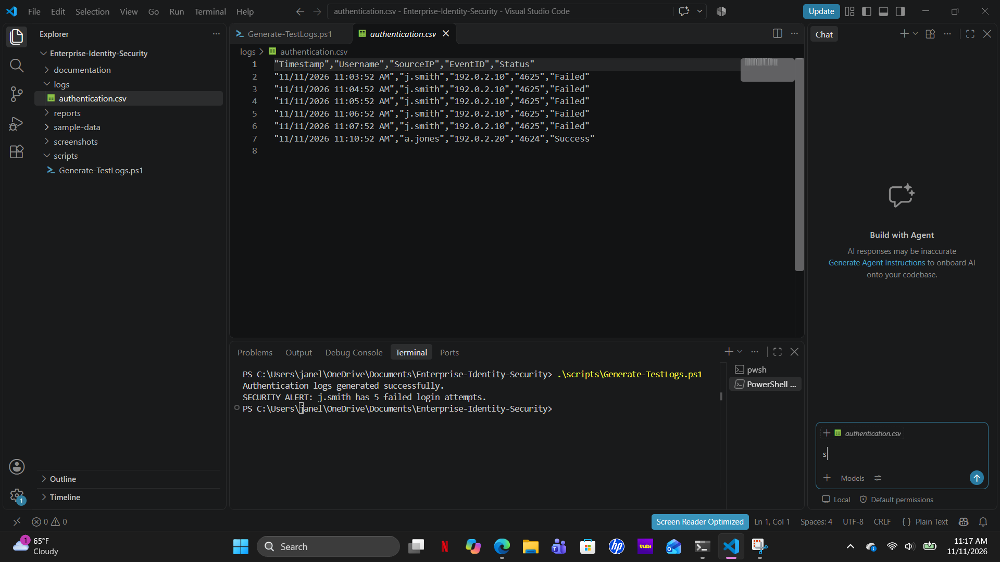

# Enterprise Identity Security Monitoring & Incident Detection

## Project Overview

This project demonstrates the development of a PowerShell-based security monitoring and incident detection system within a simulated enterprise environment.

The project focuses on analyzing authentication activity, identifying suspicious login attempts, and documenting potential security incidents using Security Operations Center (SOC) investigation practices.

## Tools & Technologies

- PowerShell 7
- Visual Studio Code
- Windows Authentication Event IDs
- CSV Log Analysis
- Security Incident Documentation

## Project Objectives

- Generate simulated authentication logs
- Identify failed login attempts using Event ID 4625
- Detect multiple failed login attempts
- Generate automated security alerts
- Investigate suspicious authentication activity
- Document findings in an incident report

## Security Detection Results

The PowerShell script successfully generated simulated authentication events and identified suspicious login activity.

### Investigation Findings

- Account: j.smith
- Source IP Address: 192.0.2.10 (Simulated)
- Event ID: 4625
- Failed Login Attempts: 5
- Detection Status: Successful
- Alert Type: Multiple Failed Authentication Attempts

The detection system generated the following alert:

SECURITY ALERT: j.smith has 5 failed login attempts.

## Project Structure

- scripts/Generate-TestLogs.ps1
- logs/authentication.csv
- reports/Incident-Report-001.md
- screenshots/Day1-Authentication-Detection.png

## Skills Demonstrated

- PowerShell Scripting
- Security Event Monitoring
- Authentication Log Analysis
- Threat Detection
- SOC Investigation
- Incident Response Documentation
- Security Automation

## Future Improvements

- Integrate Windows Event Viewer logs
- Develop advanced brute-force detection
- Implement automated reporting
- Integrate Microsoft Sentinel or Splunk
- Expand identity and access monitoring

## Project Disclaimer

This project uses fictional accounts, simulated authentication events, and test IP addresses for educational and cybersecurity portfolio purposes.
## Security Detection Results

The PowerShell script successfully detected five
simulated failed authentication attempts and
generated a security alert.

